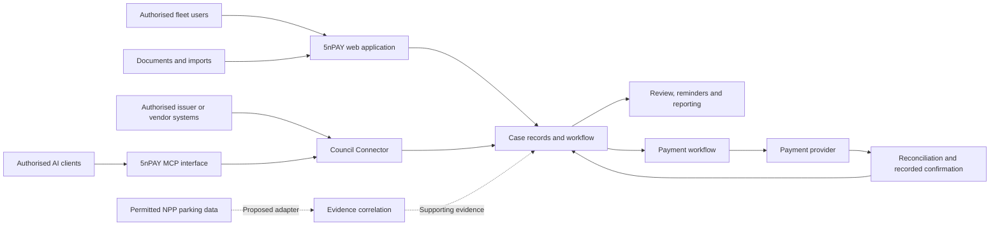

# 5nPAY

## Fleet penalty-notice management with traceable evidence and controlled integrations

**Publisher:** DYMORA LIMITED, trading as 5nPAY

**Document:** Public product and architecture overview

**Version:** 1.0.0

**Prepared:** 21 October 2026

**Website:** [www.5npay.co.uk](https://www.5npay.co.uk/)

Copyright © 2026 DYMORA LIMITED. Use of this document is governed by the [publication licence](LICENSE.md).

## Abstract

5nPAY is a UK-focused platform for organising penalty notices and related fleet compliance work. Its approach combines document capture, reviewable extraction, deadline tracking, evidence records and controlled partner integrations. The objective is to make each notice easier to understand and manage while preserving the distinction between information supplied by a user, information reported by an authorised issuer and information inferred from related parking activity.

This paper presents the product model and a high-level architecture. It also describes the 5nPAY Council Connector and Model Context Protocol (MCP) interface, and a proposed integration with parking-right and session data using the National Parking Platform (NPP). An integration proposal is not a claim of access or accreditation. Production acceptance, contractual permissions and measured results are separate matters.

The paper is intended for fleet operators, potential integration partners, technical evaluators and other stakeholders considering the product. It does not disclose implementation algorithms, proprietary matching rules or operational configuration.

## 1. The operational problem

A fleet may receive notices associated with different vehicles, drivers, locations and organisations. Staff must determine what a notice concerns, record the relevant dates, assign responsibility, gather evidence and follow the appropriate payment or challenge process. Information can arrive through photographs, scanned documents, spreadsheets and separate issuer portals.

These tasks become harder when several people handle the same case or when a later communication changes its status. A useful system must preserve where information came from and when it was received. It must also make uncertainty visible: a record imported by a fleet employee has a different evidential basis from an authenticated update received from an issuing organisation.

5nPAY addresses this administrative workflow. It does not determine legal liability or replace the issuing body's decision and appeal processes. Official guidance remains the starting point for the applicable route; for example, GOV.UK directs motorists to the relevant organisation when paying a parking fine.[1]

## 2. Product proposition

The product brings three activities into one working record:

1. **Organise the notice.** Capture or import the document, review key fields, associate it with the appropriate fleet context and track dates and actions.
2. **Understand the evidence.** Keep source information and authorised external updates distinguishable from user-entered details and suggested interpretations.
3. **Track the outcome.** Record the action taken and the evidence supporting the resulting status, including follow-up where confirmation is incomplete.

The intended commercial model combines free basic notice guidance with subscriptions for fleet workflow and administration. Pricing, eligibility and feature availability are governed by the current product terms. No conversion rate, market share, revenue forecast or customer saving is asserted in this paper.

The design is relevant to fleet managers, operations teams and authorised administrators handling notices across multiple vehicles. Partner interfaces serve organisations entitled to supply or receive the relevant data.

## 3. The notice lifecycle

### Capture and review

5nPAY has developed interfaces for manual entry, structured import and document scanning. Optical character recognition can suggest fields such as a notice reference, vehicle registration, issuer and dates. The result needs review: extracting text from an image does not establish that the notice is genuine or that every field is correct.

The product approach retains a distinction between the source document and the reviewed working record. A user should be able to correct an extraction and understand which values have been supplied or confirmed.

### Assignment and deadlines

A reviewed record can be placed in the fleet's working context and assigned to an authorised user. Dates support reminders and work queues. The applicable document and issuer guidance remain relevant when interpreting deadlines; a generic reminder must not be treated as a legal determination.

Notification design should balance useful alerts with recipient preferences and repeat suppression. The purpose is to help staff act on a case, not to generate messages when nothing material has changed.

### Action and outcome

An authorised user decides how to proceed using the available evidence. The platform can organise payment or appeal-related work and record its progress. Submission, receipt and final outcome are separate states. A draft challenge is not a submitted appeal, and receipt of money by an intermediary is not evidence that an issuer has settled or closed a notice.

## 4. What verification means

The word *verification* can describe several different checks. The product model separates them:

| Check | What it can establish | What it does not establish by itself |
|---|---|---|
| Document extraction | Text and fields suggested from a supplied document | Authenticity, liability or issuer acceptance |
| Official-site guidance | A comparison with a known official destination or published guidance | That an issuer actually issued the particular notice |
| Authorised issuer-record match | A matching record and reported state within the source's permitted coverage | Coverage of all issuers, or the correctness of every underlying decision |
| Parking-right/session correlation | Related parking evidence for a vehicle, place and time, where access is authorised | Automatic cancellation of a notice, or confirmation of payment of that notice |
| Payment reconciliation | A relationship between a payment record and the relevant case or account | Final issuer settlement without the required acknowledgement |

An absent match is inconclusive where coverage, freshness or identifiers are incomplete. A useful result therefore needs its source, timing, scope and limitations. The system should represent unknown or unavailable evidence explicitly rather than converting it into an assurance.

## 5. High-level system design

The following diagram shows conceptual responsibilities. The NPP adapter is proposed and subject to onboarding and permission.

The web application provides the working interface. Case records hold the operational history. External adapters apply the access conditions and data meanings of their respective sources. Reporting and reminders use the resulting record without changing the origin of the evidence.

Tenant boundaries, user permissions and partner permissions are separate concerns. A fleet administrator's authority within a customer account does not automatically confer authority to administer every integration partner or access another fleet's records. These boundaries are acceptance requirements for the design and need release-specific testing.

## 6. Council Connector and 5nPAY MCP

The Council Connector is the partner interface for exchanging notice lifecycle information with authorised organisations. The implementation work includes partner credentials, council-specific access and separation of test and live activity. Its purpose is to connect information to the correct source and permitted context.

The separate 5nPAY MCP component exposes selected partner API operations to compatible AI clients. Its locally validated initial interface includes checking the configured partner identity and querying a notice reference. Optional event-push tools require explicit enablement and appropriate API permissions. A tool invocation does not grant authority that the underlying API has not assigned.

The MCP component uses 5nPAY partner credentials. It is distinct from the NPP integration and from payment-provider authentication. The initial interface does not collect payments. A query may also register interest in later updates, so integration documentation must describe its effects rather than treating every query as entirely passive.

Source review and a local MCP handshake are useful engineering evidence, but they do not establish successful production onboarding. A full acceptance journey still requires a valid test partner, permitted data and confirmation that the deployed backend behaves as intended.

## 7. APDS and the proposed NPP integration

The Alliance for Parking Data Standards (APDS) provides a common model and API specification for exchanging parking information.[2] NPP publishes its own implementation guidance and API references.[3] The general standard and the platform-specific contract have different roles: a compliant data structure alone does not grant permission to read platform records.

5nPAY's proposed NPP use is to associate authorised parking-right or session evidence with a case under review. This work depends on the approved use case, credentials, location permissions, available historical coverage and the relevant agreements. It is not presented as a national notice-authentication service or an automatic PCN payment channel.

NPP's published Connected Supplier guide distinguishes access roles and constrains their data access. Its Service Provider role is limited to self-created right/session records, while Enforcement Provider access is constrained to contracted and subscribed locations.[4] Consequently, fleet access to sessions purchased through another service cannot be assumed from completion of APDS training or possession of an API specification.

This edition claims no NPP production connection, accreditation, partnership or endorsement. Any future connection should publish its actual coverage and limitations alongside the feature.

## 8. Payment integrity and data stewardship

The payment design separates a fleet subscription from a payment associated with a specific notice. Each requires the correct account, amount, currency, environment and provider reference. Duplicate or delayed notifications must not produce duplicate charges or contradictory case outcomes. Cancellation, failed payments, refunds and issuer reconciliation require distinct handling and evidence.

The last payment audit used for this edition was on 9 October 2026. It did not establish readiness for live payments. The architecture described here therefore must not be read as confirmation that every payment capability is deployed or accepted for production use.

Data stewardship objectives include collecting information needed for the task, restricting access, keeping useful audit evidence and applying documented retention decisions. Personal data and credentials do not belong in public documentation or public issue reports. These are design commitments to evaluate, not a claim of independently certified security or data-protection compliance.

## 9. Evidence, maturity and evaluation

This publication draws on the product design, implementation records and engineering checks available to the publisher. The latest operational checks relied on here are dated 9 October 2026. This paper does not re-certify the live service as of its preparation date.

| Area | Evidence represented in this edition |
|---|---|
| Notice capture and fleet workflow | Developed product components; results depend on the deployed release and user workflow |
| Basic free notice guidance | Limited guidance and destination checks; universal authenticity verification is not claimed |
| Council Connector | Implemented integration components; each partner requires authorisation and acceptance |
| 5nPAY MCP | Local compilation and protocol/tool-discovery check completed; public distribution and authenticated production operation not established by that check |
| Payment workflow | Implemented components and further stabilisation work; live-payment readiness not established by the referenced audit |
| NPP correlation | Proposed integration requiring access approval and validation |

Evaluation should measure field accuracy on representative documents, staff correction time, completed-case handling time, reminder usefulness, false matches and unknown results, as well as permission failures and payment reconciliation outcomes. Claims of time savings, accuracy or fraud reduction should identify the sample, comparison method and evaluation period.

The next product milestones are reliable payment acceptance, production hardening, partner onboarding and pilot evaluation. NPP correlation can be evaluated as a separate workstream without claiming broader data access than has been granted.

## 10. Publication and intellectual property

This paper records DYMORA LIMITED's presentation of the 5nPAY product approach in the form and version stated above. The publication licence applies to the original text and diagrams supplied in this repository. Third-party standards, software, names and documentation retain their own rights and terms.

Publication is not a patent filing, trade-mark registration, certification or conclusive proof of inventorship. Copyright in a document does not confer exclusive ownership of every idea, workflow or standard it describes. This edition does not assert that the individual techniques or their combination are legally novel.

Repository history, release identifiers and file hashes help readers identify the version they consulted. They are not an independent determination of priority or ownership. The [IP notice](IP-NOTICE.md) explains these limits and the scope of the document licence.

## References

1. GOV.UK, [Pay a parking fine](https://www.gov.uk/pay-parking-fine). Official starting point for the payment route.
2. Alliance for Parking Data Standards, [APDS API specification](https://github.com/parkingdata/spec). External standard; its own terms apply.
3. National Parking Platform, [Developer documentation](https://docs.npp.org.uk/).
4. National Parking Platform, [Connected Supplier Developer Guide v1.0, 14 April 2026](https://docs.npp.org.uk/assets/pdf/20260414%20NPP%20CS%20Developer%20Guide%20v1.0.pdf), particularly page 17 on access controls.

External sources describe their respective services or standards. Their inclusion does not imply endorsement of 5nPAY. Product-specific statements are the publisher's account, with the evidence limitations stated in section 9.

---

Publication enquiries: **abiboe@dymora.co.uk** · [5npay.co.uk](https://www.5npay.co.uk/)
